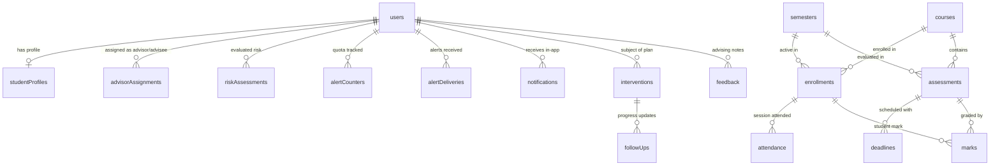
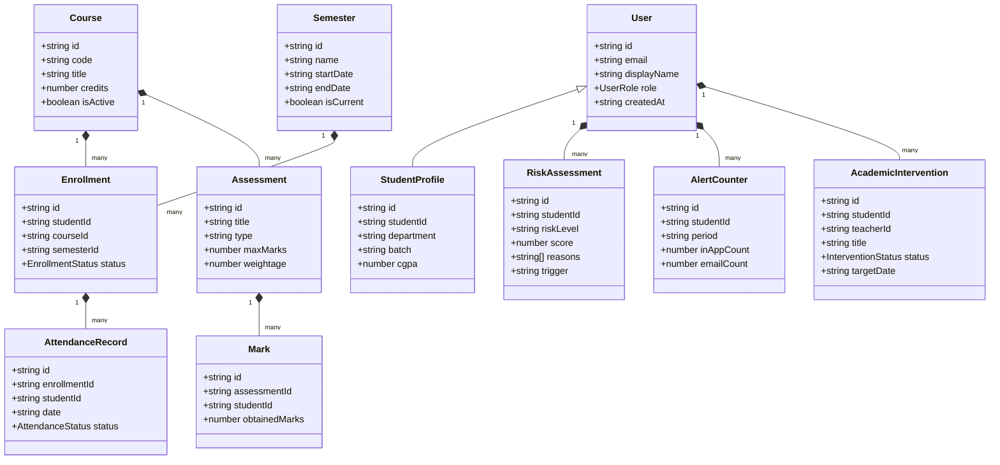
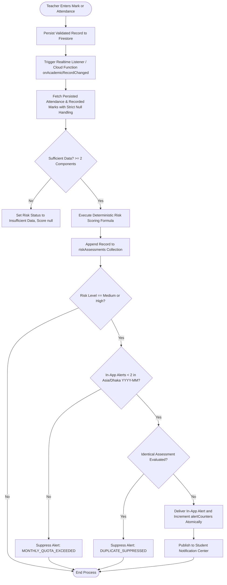
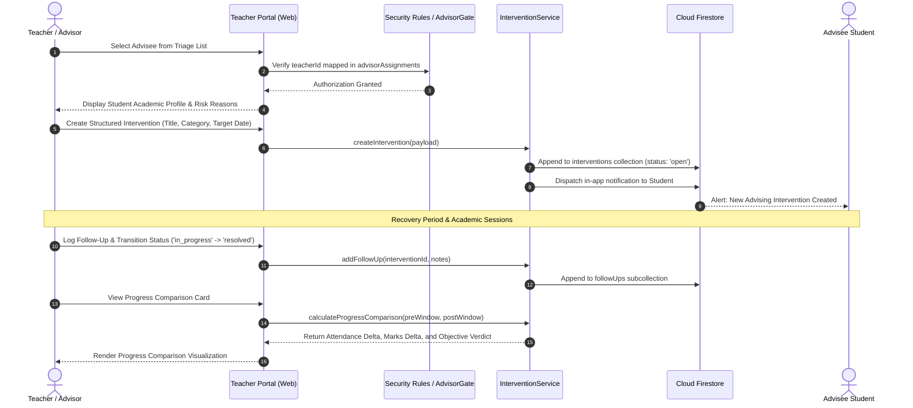

# System Architecture: Academic Risk Alert System

## 1. Overview
The Academic Risk Alert System is a university software engineering system designed to identify students at academic risk using rule-based metrics across attendance, continuous assessments, assignments, and exam marks.
The platform enables:
- **Students**: track continuous academic progress, view attendance and mark summaries, understand transparent risk factors, and view advisor notifications.
- **Teachers / Advisors**: monitor assigned students, identify students flagged as Medium or High risk, log feedback, initiate structured academic interventions, and track follow-up progress.
- **Administrators**: manage user roles, semester terms, course definitions, and system configurations.

## 2. Team and Module Ownership
Three developers collaborate on this unified platform:
- **Developer 1 (Md. Al-Maynul Hasan)**: Core application shell, authentication & role management, student portal, academic management, and cross-module integration coordination.
- **Developer 2 (Md. Al Arafat abir)**: Rule-based risk engine, automated alert dispatch, notification center, reminder queues, and actionable recommendations.
- **Developer 3 (Abu Sayed)**: Teacher/advisor dashboard, student risk review, record updates, direct feedback, structured academic interventions, and follow-up tracking.

## 3. Technology Stack & Key Decisions
- **Frontend**: React 19 + TypeScript + Tailwind CSS (v4) + React Router v7.
- **Backend & Database**: Firebase Authentication (Email/Password) + Cloud Firestore (Single backend).
- **Theme**: Light mode strictly (`#F8FAFC` background, `#FFFFFF` surface, `#E2E8F0` borders). No dark mode.
- **Timezone**: `Asia/Dhaka` (UTC+6) for all calendar dates and scheduling display; timestamps stored strictly in UTC ISO / Firestore Timestamp.
- **Role Model**: Three roles: `student`, `teacher`, `admin`. Stored in the `users` collection. Registration defaults strictly to `student`. Roles are write-protected and can only be modified by administrators.
- **Risk Evaluation**: Strictly rule-based and deterministic (Low, Medium, High). No AI / Machine Learning terminology or black-box predictions.

## 4. Role-Aware Route Table
| Route Path | Allowed Roles | Description | Module Owner | Status |
|---|---|---|---|---|
| `/login` | Public (Unauthenticated) | User login via Firebase Auth | Dev 1 (Core) | Verified & Operational |
| `/register` | Public (Unauthenticated) | Registration (defaults to student) | Dev 1 (Core) | Verified & Operational |
| `/forgot-password` | Public (Unauthenticated) | Password reset request (anti-enumeration) | Dev 1 (Core) | Verified & Operational |
| `/reset-password` | Public (Unauthenticated) | Password reset confirmation flow | Dev 1 (Core) | Verified & Operational |
| `/student/dashboard` | `student` | Student overview & real-time risk level badge | Dev 1 (Student) | Verified & Operational |
| `/student/courses` | `student` | Enrolled courses list & syllabi credits | Dev 1 (Student) | Verified & Operational |
| `/student/attendance` | `student` | Detailed attendance records & percentage | Dev 1 (Student) | Verified & Operational |
| `/student/marks` | `student` | Continuous assessments and exam marks (strict nulls) | Dev 1 (Student) | Verified & Operational |
| `/student/performance` | `student` | Performance trends, grades & recommendations | Dev 1 (Student) | Verified & Operational |
| `/student/notifications`| `student` | Advising alerts, reminders & acknowledgment | Dev 2 (Risk) | Verified & Operational |
| `/student/profile` | `student` | Student profile, CGPA & contact info | Dev 1 (Core) | Verified & Operational |
| `/teacher/dashboard` | `teacher`, `admin` | Advisor dashboard & risk summary triage | Dev 3 (Teacher) | Verified & Operational |
| `/teacher/students` | `teacher`, `admin` | Assigned advisees list with risk badges | Dev 3 (Teacher) | Verified & Operational |
| `/teacher/students/:id` | `teacher`, `admin` | Student detailed academic & risk profile with entry | Dev 3 (Teacher) | Verified & Operational |
| `/teacher/interventions`| `teacher`, `admin` | Active academic intervention plans & progress | Dev 3 (Teacher) | Verified & Operational |
| `/admin/users` | `admin` | User accounts, roles & assignments | Dev 1 (Core) | Verified & Operational |

## 5. Security & Isolation Model
1. **Student Isolation**: Students may only read documents where `studentId == request.auth.uid` or `userId == request.auth.uid`.
2. **Advisor Scope**: Teachers may only read and intervene on students explicitly mapped via the `advisorAssignments` collection (`teacherId == request.auth.uid`).
3. **Role Elevation Shield**: Users cannot self-assign or mutate the `role` field in `users` documents.
4. **Append-Only Auditing**: `feedback`, `riskAssessments`, and `followUps` are append-only to preserve academic audit trails.
5. **Server Authority**: Risk calculation outputs, alert counter quotas, and alert deliveries are write-restricted to authorized server processes or admin transactions.

---

## 6. Canonical Entity-Relationship (ER) Model

All collections follow unified camelCase naming without legacy snake_case variants:

---

## 7. UML Architecture Models & Authorship

### 7.1 Class Diagram — Md. Al-Maynul Hasan (Developer 1)

### 7.2 Activity Diagram: Academic Record Update to Risk Reevaluation — Md. Al Arafat Abir (Developer 2)

### 7.3 Sequence Diagram: Advisor Academic Intervention & Progress Lifecycle — Abu Sayed (Developer 3)

---

## 8. Release Readiness & Deployment Classification

| Component | Architecture Tier | Local / In-Memory Test | Firebase Emulator Test | Live Deployed Cloud Status |
| :--- | :--- | :--- | :--- | :--- |
| **Deterministic Risk Engine** | Pure Domain Logic | Verified (`testRiskEngine.ts`) | Verified (`testIntegrationE2E.ts`) | Ready for production runtime |
| **Asia/Dhaka Monthly Quota** | Server Authority | Verified (`testHardenRiskAlerts.ts`) | Verified (`trustedQuotaEngine.ts`) | Deployed via `/api/alerts/deliver` proxy & Cloud Functions |
| **Academic Admin & Catalog** | Service / API Layer | Verified (`testAcademicAdmin.ts`) | Verified (`testIntegrationE2E.ts`) | Active in Firestore |
| **Cross-Client Reevaluation** | Event & Sync Layer | Verified (`testHardenRiskAlerts.ts`) | Verified (`realtimeSync.ts`) | Supported by Cloud Firestore realtime listeners (`onSnapshot`) + Cloud Function trigger |
| **Scheduled Risk Sweeper** | Background Runner | Verified (`scripts/runScheduledRiskJob.ts`) | Verified (batch simulation) | Cloud Scheduler command documented in `docs/CLOUD_FUNCTIONS.md` |

